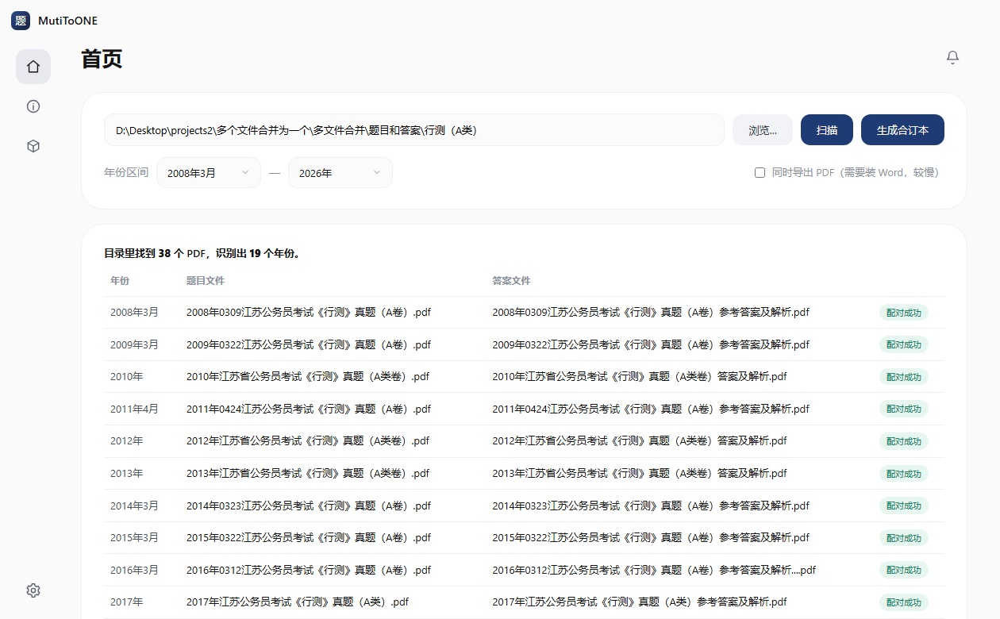
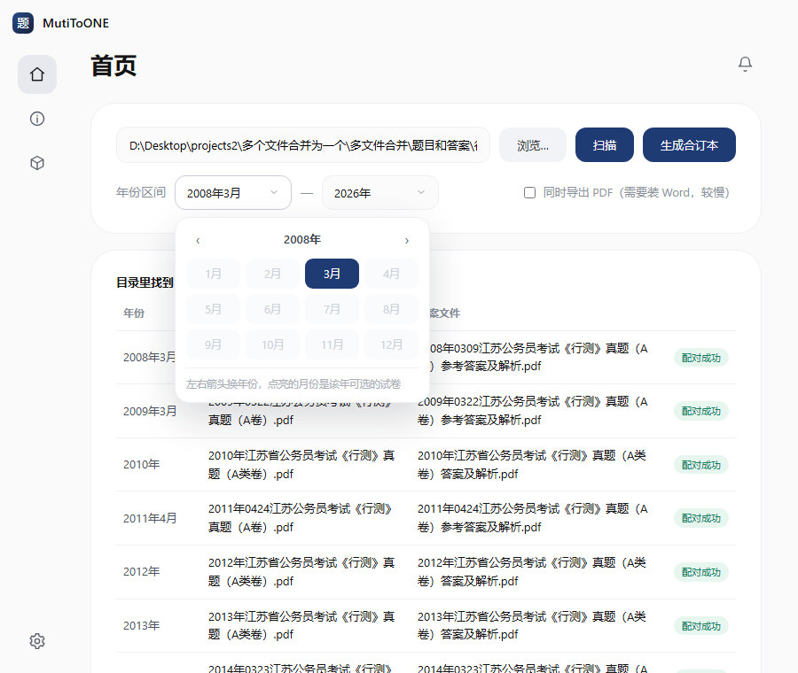
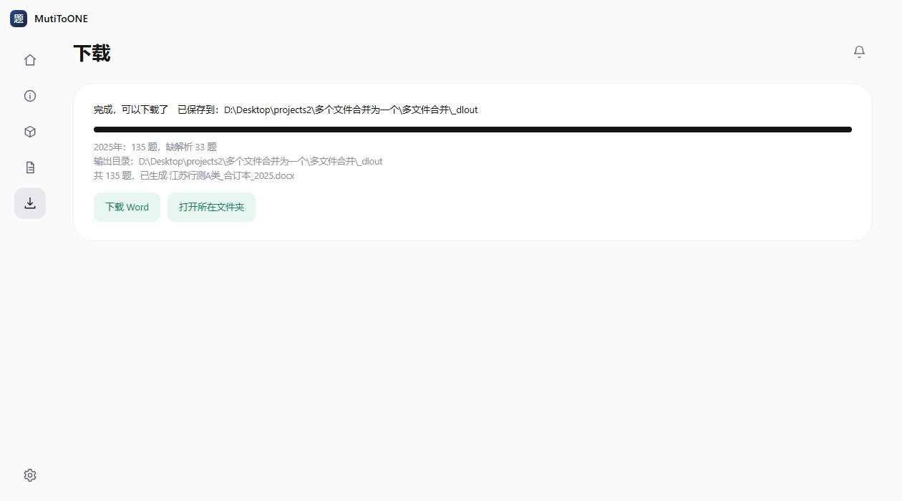
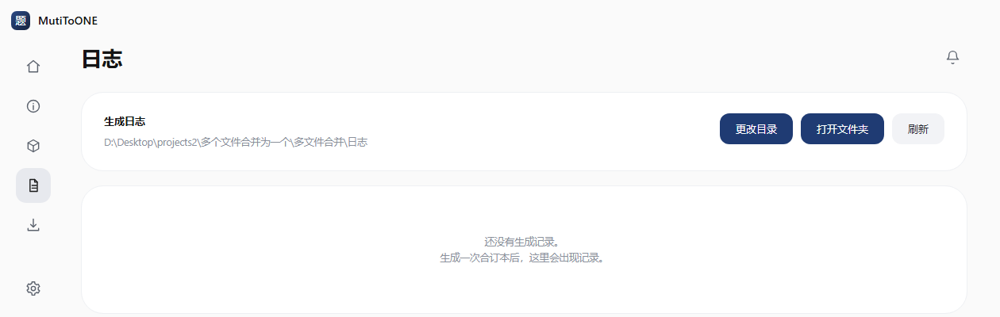
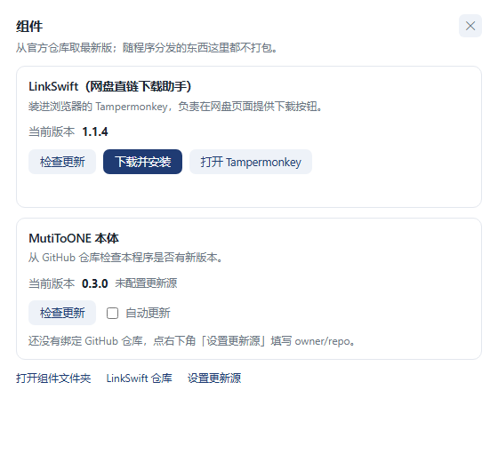

# MutiToONE · 真题合订本生成器

把「**一年一个文件、题目与答案分开放**」的真题 PDF，自动合成一本
「**题目 1 → 答案 1 → 解析 1 → 题目 2 → …**」的合订本（Word / PDF）。

程序按题号把两份 PDF 切开再重新对齐：图形题保留原图，资料分析的公共材料挂在所属题组前面，
最后排成一本可以直接翻、直接练的书。

> 自带示例数据是江苏省考《行测》(A类) 2008–2026，共 19 个年度、2295 道题，
> 其中 2065 题带答案与解析（90%）。程序本身**不限于公务员考试**。



## 下载与安装

### 方式一：下载一个 .bat 就能用（推荐）

1. 去 **[Releases](../../releases/latest)** 下载 **`MutiToONE.bat`**（3 KB）
2. 放到任意文件夹，**双击**

第一次运行会自动下载程序本体（约 1 MB）并解压到旁边的 `MutiToONE\` 文件夹，之后就秒开。
只有 Python 需要你自己装（见下）。

> 只想离线用的话：克隆本仓库或下载 ZIP，解压后双击里面的 `启动工作台.bat`。

### 方式二：本仓库源码

```bat
git clone https://github.com/Sy001-jpj/MutiToONE.git
cd MutiToONE
pip install -r requirements.txt
```

然后双击 `启动工作台.bat`，或者命令行：

```bat
python -m hebing serve              :: 起服务并打开浏览器
python -m hebing serve --no-browser :: 只起服务
```

## 环境要求

| 项 | 要求 |
|---|---|
| 系统 | Windows 10 / 11（64 位） |
| Python | 3.10 及以上（3.12 验证过） |
| 依赖 | `pip install -r requirements.txt` |
| Word | 可选，只有勾选「同时导出 PDF」时才需要 |

## 自动更新

程序自带更新检查（左侧「组件」→ MutiToONE 本体）：

- 每次启动会去 GitHub 查最新 Release
- 发现新版本 → 顶部铃铛亮红点 → 点开可以查看更新内容
- 「自动更新」开着的话会直接下载并替换程序文件，**重启程序即生效**
- 更新只替换 `hebing\` 里的代码，**不会动**你的 `输出\`、`日志\`、`组件\` 和设置

## 使用步骤

1. 双击 `启动工作台.bat`，浏览器会自动打开工作台
2. 点 **浏览…** 选中真题 PDF 所在文件夹 → 点 **扫描**
3. 确认表格里每年的「题目 / 答案」配对正确，选年份区间
4. 点 **生成合订本** → 选择存放位置 → 等进度走完

成品统一命名 `合订本.docx`（勾选导出 PDF 时另有 `合订本.pdf`）。

## 能识别什么、不能识别什么

**只能处理带文字层的 PDF（非扫描件）。** 程序靠读取 PDF 里的文字来判断题号、选项和解析位置，
整页只有图像、复制不出字，就读不到题号，这类文件无法解析。

| 可用 | 不可用 |
|---|---|
| 考试机构官网 / 题库下载的正规 PDF | 手机拍照转的 PDF |
| Word、WPS 导出的 PDF | 扫描仪扫的 PDF |
| 有文字层的电子版 | 整页截图的 PDF |

自查方法：用阅读器打开，**能选中并复制文字**的就行；拖选一片全是蓝框、复制不出字的，就是扫描件。
（本程序不含 OCR。）

## 界面

| | |
|---|---|
|  |  |
|  |  |

## 目录结构

```
├── hebing/                源码包
│   ├── pdfio.py           PDF 读取：坐标重排、噪声过滤、图片裁剪
│   ├── parse.py           题号切分、弱锚点修复、答案解析抽取
│   ├── classify.py        文件配对（年份 + 月份，含兜底规则）
│   ├── build.py           组装每年题目数据
│   ├── render.py          Word / Markdown 排版
│   ├── serve.py           本地 HTTP 服务 + 全部接口
│   ├── selfupdate.py      GitHub Release 检查与自动更新
│   ├── components.py      LinkSwift / Tampermonkey 组件管理
│   ├── webui.html         工作台界面
│   ├── components.html    组件窗界面
│   └── update.html        更新卡片界面
├── userscript/            配套油猴脚本（可选）
├── 预览/                  界面截图
├── 启动工作台.bat          启动入口
└── requirements.txt
```

## 关于 LinkSwift

工作台里的「组件」可检查并下载 [LinkSwift](https://github.com/hmjz100/LinkSwift)（网盘直链下载助手）。

**本仓库不分发它**：LinkSwift 使用 AGPL-3.0，程序只在用户点击时从官方仓库拉取最新版，
存到本机 `组件/` 目录，再从那里装进浏览器的 Tampermonkey。

## 发版流程（维护者）

1. 改 `hebing/__init__.py` 里的 `__version__`（例如 `0.3.1`），提交到 main
2. 打一个源码 zip（可选，给离线用户）：压缩仓库根目录，命名 `MutiToONE-v0.3.1.zip`
3. GitHub → Releases → Draft a new release → Tag `v0.3.1` → 上传 `MutiToONE.bat`（可选再加一个源码 zip）→ Publish
4. 已安装的用户下次启动就会收到更新提示

## 许可

代码采用 MIT 许可。示例真题数据不随仓库分发，版权归原出题机构所有。
